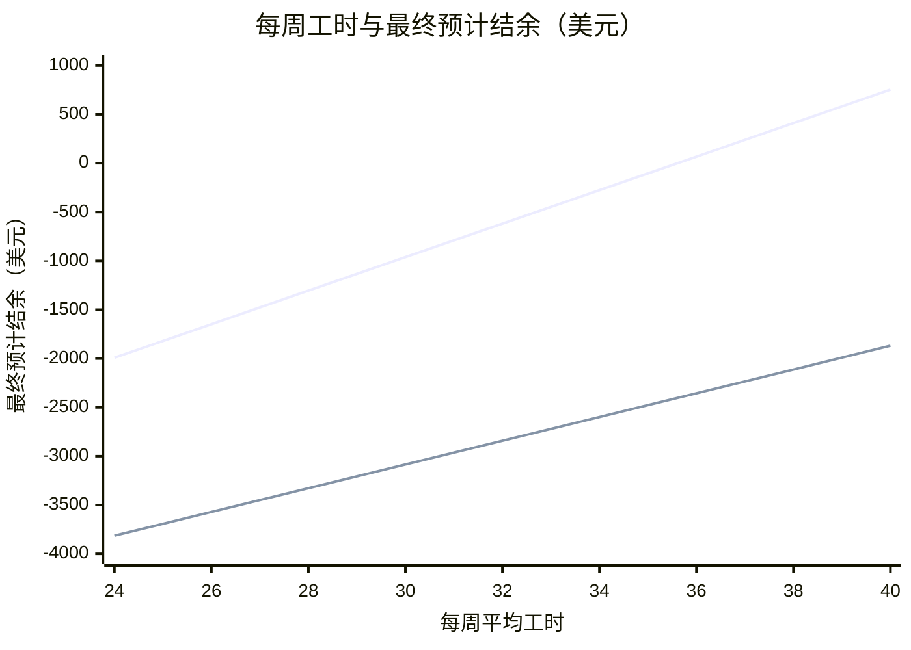

# 岗位分析标准示例

根据真实 Offer 整理（Meredith Dunkin、North Myrtle Beach），汇率为 2026 年 11 月 11 日人民币中间价，项目费为默认估算；数字不代表当季实际报价。下面是按[Offer 字段提取模板](offer-extraction.md)填写的输入与 `budget.py` 的输出，实际回答原样使用脚本输出。

---

**示例一：宿主漏读字段时，先请用户补充**

```json
{"mode":"position_overview","fx_cny_per_usd":6.8,"fx_source":"人民币中间价 6.7191","fx_quote_date":"2026-11-11","offers":[{"id":"meredith","label":"Meredith Dunkin","city":"Meredith","state":"NH","wage_usd_per_hour":14.5,"hours_per_week":32,"rent_usd_per_week":100,"details":{"sponsor":"CHI","tips":true,"housing_utilities_included":true,"housing_deducted_from_pay":true,"housing_furnished_kitchen":true,"housing_people_per_room":"2–4","housing_contract":true,"commute_bike_minutes":40,"commute_drive_minutes":12,"employer_transport":"assist","ssn_required_before_work":true,"ssn_employer_assist":true,"ssn_office":"Concord, NH","ssn_office_miles":30,"start":"尽快","training_reduced_hours":true,"open_availability":true,"multiple_locations":3,"dress_code":"自备防滑鞋、蓝色牛仔裤，以及纯黑或纯白的有领 Polo 衫。","arrival":"从波士顿 Logan 机场坐 Concord Coach 大巴到 Meredith，约 2 小时；提前告知雇主到达时间，可能安排车站接人；深夜到达需自订旅舍，每晚 $50 起。","area":"位于新罕布什尔湖区（Lake Winnipesaukee 一带），靠近白山，适合户外活动。","nearest_city":"Boston","nearest_city_hours":2,"customer_facing":true,"english_level":"Intermediate","amenities":["超市","洗衣房"],"cultural_activities":"雇主每年办员工 BBQ。"}}]}
```

我这里检测不到以下信息，麻烦你看一遍 Offer 提供给我：

**Meredith Dunkin**

- 工作起止日期（Start / End date）
- 餐饮安排（Meals）
- 住宿押金（Deposit amount）
- 能否找二工（Possibility to find a second job）

Offer 上确实没写的，回复「没写」，我按估算继续。

> 用户补充后把字段写进输入；回复“没写”的保持省略，并在顶层加 `"missing_confirmed": true` 再运行。

---

**示例二：单 Offer**

```json
{"mode":"position_overview","fx_cny_per_usd":6.8,"fx_source":"人民币中间价 6.7191","fx_quote_date":"2026-11-11","offers":[{"id":"meredith","label":"Meredith Dunkin","city":"Meredith","state":"NH","wage_usd_per_hour":14.5,"hours_per_week":32,"rent_usd_per_week":100,"details":{"sponsor":"CHI","tips":true,"meals":"free_at_work","housing_utilities_included":true,"housing_deducted_from_pay":true,"housing_furnished_kitchen":true,"housing_deposit_usd":0,"housing_people_per_room":"2–4","housing_contract":true,"commute_bike_minutes":40,"commute_drive_minutes":12,"employer_transport":"assist","second_job_allowed":true,"ssn_required_before_work":true,"ssn_employer_assist":true,"ssn_office":"Concord, NH","ssn_office_miles":30,"start":"尽快","training_reduced_hours":true,"open_availability":true,"multiple_locations":3,"dress_code":"自备防滑鞋、蓝色牛仔裤，以及纯黑或纯白的有领 Polo 衫。","arrival":"从波士顿 Logan 机场坐 Concord Coach 大巴到 Meredith，约 2 小时；提前告知雇主到达时间，可能安排车站接人；深夜到达需自订旅舍，每晚 $50 起。","area":"位于新罕布什尔湖区（Lake Winnipesaukee 一带），靠近白山，适合户外活动。","nearest_city":"Boston","nearest_city_hours":2,"customer_facing":true,"english_level":"Intermediate","amenities":["超市","洗衣房"],"cultural_activities":"雇主每年办员工 BBQ。"},"offer_start_date":"2026-06-01","offer_end_date":"2026-08-31"}]}
```

**假设项目费 ¥25,000，按 $14.50/h、平均每周 32 小时计算，在美净剩约 $3,057，最终预计结余约 −$619（约 −¥4,212），单靠本岗位无法回本。**

## 1. 六维分析

| 要素 | Offer 数据 | 分析 |
|---|---|---|
| 收入 | $14.50/h；平均 32h/周；6/1–8/31，约 13.1 周 | 无州所得税，约 10% 的联邦税费 |
| 住宿 | $100/周 | 水电网全包，从工资扣除，带家具和厨房 |
| 生活成本 | 餐饮 $50/周（估）；其他 $15/周（估） | 上班期间免费餐饮；NH 每周基础开销低于 $50；无州销售税 |
| 交通 | $20/周（估） | 住处到岗骑车约 40 分钟，开车约 12 分钟；雇主协助安排交通；公共交通很弱 |
| 二工 | 可以（需 CHI 批准） | 二工收入不计入回本 |
| 落地便利 | 需先有 SSN 才能开工；雇主协助办理 | 最近的 SSA 在 Concord, NH（约 30 英里）；到岗时间：尽快 |

## 2. 回本测算

| 项目 | 每周 | 13.1 周合计 |
|---|---|---|
| 税前工资 | $464 | $6,098 |
| 预计税费 | −$46 | −$610 |
| 住宿 | −$100 | −$1,314 |
| 餐饮、交通及其他 | −$85 | −$1,117 |
| **在美净剩** | **$233** | **$3,057** |
| 项目费（¥25,000，估） |  | −$3,676 |
| **最终预计结余** |  | **−$619** |

回本进度：▓▓▓▓▓▓▓▓░░ 83%
每周净剩 $233，覆盖项目费需要约 16 周。要在 13.1 周内回本，每周平均需工作约 36 小时。

汇率 6.8：11 月 11 日人民币中间价 6.7191，向上取一位小数。

## 3. 特殊注意事项

- **项目费**：Offer 未写明，测算按项目费 ¥25,000 估算，填入实际数字后可重新测算。
- **SSN 与开工**：必须先拿到 SSN 才能上班，等待期间没有收入，到岗后应尽快办理。
- **培训期工时**：培训期每周工时通常低于平均值，前几周收入会偏少。
- **小费**：岗位有小费，金额不固定，未计入回本。
- **排班与门店**：须接受夜班、周末和节假日排班；雇主有 3 家门店，到岗后可能调整工作地点。
- **二工审批**：须先取得 CHI 书面批准才能开始，且不得影响一工工时。
- **住房合同与押金**：不收押金；2–4 人一间；到岗时签住房合同。
- **着装自备**：自备防滑鞋、蓝色牛仔裤，以及纯黑或纯白的有领 Polo 衫。
- **抵达路线**：从波士顿 Logan 机场坐 Concord Coach 大巴到 Meredith，约 2 小时；提前告知雇主到达时间，可能安排车站接人；深夜到达需自订旅舍，每晚 $50 起。
- **生活配套**：住处附近步行可达超市、洗衣房。
- **工作英语环境**：岗位面向顾客，日常用英语沟通；雇主要求英语 Intermediate。
- **文化交流**：雇主每年办员工 BBQ。
- **周边与出行**：距 Boston 约 2 小时。
- **SWT 地点背景**：BridgeUSA SWT 地图上，Meredith 的参与者计数为 69（全国城市第 256 位）；NH 共 2,421（全国第 15 位）；当地没有官方 Community Support Group。计数不等同于年度去重人数。
- **地域特色**：位于新罕布什尔湖区（Lake Winnipesaukee 一带），靠近白山，适合户外活动。

## 4. 后续选项

A. 填入实际项目费或小费，重新测算
B. 与其他岗位对比
C. 查看住宿、工作内容与当地生活
D. 判断是否值得选择

回复字母或直接提问。

---

**示例三：两份 Offer**

```json
{"mode":"position_overview","fx_cny_per_usd":6.8,"fx_source":"人民币中间价 6.7191","fx_quote_date":"2026-11-11","missing_confirmed":true,"offers":[{"id":"meredith","label":"Meredith Dunkin","city":"Meredith","state":"NH","wage_usd_per_hour":14.5,"hours_per_week":32,"rent_usd_per_week":100,"details":{"sponsor":"CHI","tips":true,"meals":"free_at_work","housing_utilities_included":true,"housing_deducted_from_pay":true,"housing_furnished_kitchen":true,"housing_deposit_usd":0,"housing_people_per_room":"2–4","housing_contract":true,"commute_bike_minutes":40,"commute_drive_minutes":12,"employer_transport":"assist","second_job_allowed":true,"ssn_required_before_work":true,"ssn_employer_assist":true,"ssn_office":"Concord, NH","ssn_office_miles":30,"start":"尽快","training_reduced_hours":true,"open_availability":true,"multiple_locations":3,"dress_code":"自备防滑鞋、蓝色牛仔裤，以及纯黑或纯白的有领 Polo 衫。","arrival":"从波士顿 Logan 机场坐 Concord Coach 大巴到 Meredith，约 2 小时；提前告知雇主到达时间，可能安排车站接人；深夜到达需自订旅舍，每晚 $50 起。","area":"位于新罕布什尔湖区（Lake Winnipesaukee 一带），靠近白山，适合户外活动。","nearest_city":"Boston","nearest_city_hours":2,"customer_facing":true,"english_level":"Intermediate","amenities":["超市","洗衣房"],"cultural_activities":"雇主每年办员工 BBQ。"},"offer_start_date":"2026-06-01","offer_end_date":"2026-08-31"},{"id":"nmb","label":"North Myrtle Beach","city":"North Myrtle Beach","state":"SC","wage_usd_per_hour":11,"hours_per_week":32,"rent_usd_per_week":150,"details":{"sponsor":"CHI","tips":true,"meals":"discount","meal_discount_percent":30,"housing_utilities_included":true,"housing_deposit_usd":300,"housing_deposit_refundable":true,"housing_people_per_room":"2–4","second_job_allowed":true,"ssn_required_before_work":false,"start":"DS-2019 起始日后 1 周内","open_availability":true},"cautions":{"自找住房":"住宿非强制，须自行联系房东，周租区间 $100–175。","保底工时":"限制可排班时间会失去每周 32 小时保底。"}}]}
```

**仅从收益看，Meredith Dunkin 更高，每周多剩约 $168：最终预计结余约 −$619，North Myrtle Beach 约 −$2,842；两份岗位按当前工时都无法回本。**

## 1. 六维分析

| 要素 | 项目 | Meredith Dunkin | North Myrtle Beach |
|---|---|---|---|
| 收入 | 时薪 | $14.50/h | $11/h |
|  | 工时 | 平均 32h/周 | 平均 32h/周 |
|  | 工期 | 6/1–8/31，约 13.1 周 | 约 13 周（估） |
|  | 税费 | 约 10%，无州所得税 | 约 15%（联邦和州） |
|  | 州级时薪 | — | 处于 SC 常见 $10–12.99 区间 |
| 住宿 | 周租 | $100/周 | $150/周 |
|  | 住宿条件 | 水电网全包、从工资扣除、带家具和厨房 | 水电网全包 |
|  | 州级周租 | — | 处于 SC 常见 $100–150 区间 |
| 生活成本 | 餐饮 | $50/周（估） | $50/周（估） |
|  | 其他开销 | $15/周（估） | $15/周（估） |
|  | 餐食福利 | 上班期间免费 | 员工餐 7 折 |
|  | 州级开销 | 低于 $50 | 低于 $50 |
|  | 销售税 | 无州销售税 | 6% |
| 交通 | 交通费 | $20/周（估） | $20/周（估） |
|  | 通勤 | 骑车约 40 分钟，开车约 12 分钟 | SC 常见 6–15 分钟 |
|  | 交通安排 | 雇主协助安排 | — |
|  | 公共交通 | 很弱 | 较弱 |
| 二工 |  | 可以（需 CHI 批准） | 可以（需 CHI 批准） |
| 落地便利 | SSN | 需先有 SSN 才能开工；雇主协助办理 | 可先开工，再办 SSN |
|  | SSA 办公室 | Concord, NH（约 30 英里） | — |
|  | 到岗时间 | 尽快 | DS-2019 起始日后 1 周内 |

## 2. 回本测算

| 项目 | Meredith Dunkin | North Myrtle Beach |
|---|---|---|
| 每周净剩 | $233 | $64 |
| 工期 | 6/1–8/31，约 13.1 周 | 约 13 周（估） |
| 在美净剩 | $3,057 | $835 |
| 项目费 | −$3,676（估） | −$3,676（估） |
| **最终预计结余** | **−$619** | **−$2,842** |
| 回本进度 | ▓▓▓▓▓▓▓▓░░ 83% | ▓▓░░░░░░░░ 22% |

汇率 6.8：11 月 11 日人民币中间价 6.7191，向上取一位小数。

**岗位收益对比**



- 第 1 条线：Meredith Dunkin，平均 32 小时
- 第 2 条线：North Myrtle Beach，平均 32 小时

每周 24–40 小时之间，Meredith Dunkin 都更划算。

## 3. 特殊注意事项

**对比要点**

- **时薪**：Meredith Dunkin 高 $3.50。
- **税费**：Meredith Dunkin 低约 5 个百分点。
- **周租**：Meredith Dunkin 每周少 $50。

**两份岗位共同**

- **小费**：岗位有小费，金额不固定，未计入回本。
- **二工审批**：须先取得 CHI 书面批准才能开始，且不得影响一工工时。

**Meredith Dunkin**

- **项目费**：Offer 未写明，测算按项目费 ¥25,000 估算，填入实际数字后可重新测算。
- **SSN 与开工**：必须先拿到 SSN 才能上班，等待期间没有收入，到岗后应尽快办理。
- **培训期工时**：培训期每周工时通常低于平均值，前几周收入会偏少。
- **排班与门店**：须接受夜班、周末和节假日排班；雇主有 3 家门店，到岗后可能调整工作地点。
- **住房合同与押金**：不收押金；2–4 人一间；到岗时签住房合同。
- **着装自备**：自备防滑鞋、蓝色牛仔裤，以及纯黑或纯白的有领 Polo 衫。
- **抵达路线**：从波士顿 Logan 机场坐 Concord Coach 大巴到 Meredith，约 2 小时；提前告知雇主到达时间，可能安排车站接人；深夜到达需自订旅舍，每晚 $50 起。
- **生活配套**：住处附近步行可达超市、洗衣房。
- **工作英语环境**：岗位面向顾客，日常用英语沟通；雇主要求英语 Intermediate。
- **文化交流**：雇主每年办员工 BBQ。
- **周边与出行**：距 Boston 约 2 小时。
- **SWT 地点背景**：BridgeUSA SWT 地图上，Meredith 的参与者计数为 69（全国城市第 256 位）；NH 共 2,421（全国第 15 位）；当地没有官方 Community Support Group。计数不等同于年度去重人数。
- **地域特色**：位于新罕布什尔湖区（Lake Winnipesaukee 一带），靠近白山，适合户外活动。

**North Myrtle Beach**

- **项目费与工期**：Offer 未写明，测算按项目费 ¥25,000、工期 13 周估算，填入实际数字后可重新测算。
- **排班**：须接受夜班、周末和节假日排班。
- **住房**：押金 $300，首薪前需备现金，离开时可退；2–4 人一间。
- **SWT 地点背景**：BridgeUSA SWT 地图上，North Myrtle Beach 的参与者计数为 333（全国城市第 46 位）；SC 共 2,852（全国第 13 位）；当地没有官方 Community Support Group。计数不等同于年度去重人数。
- **自找住房**：住宿非强制，须自行联系房东，周租区间 $100–175。
- **保底工时**：限制可排班时间会失去每周 32 小时保底。

## 4. 后续选项

A. 修改工时、餐费或项目费，重新测算
B. 加入二工，测算回本所需工时
C. 查看各地住宿、工作内容与当地生活
D. 判断选择哪个岗位

回复字母或直接提问。

---

**示例四：4 份及以上 Offer，先问核心诉求**

```json
{"mode":"position_overview","fx_cny_per_usd":6.8,"fx_source":"人民币中间价 6.7191","fx_quote_date":"2026-11-11","offers":[{"id":"meredith","label":"Meredith Dunkin","city":"Meredith","state":"NH","wage_usd_per_hour":14.5,"hours_per_week":32,"rent_usd_per_week":100},{"id":"nmb","label":"North Myrtle Beach","city":"North Myrtle Beach","state":"SC","wage_usd_per_hour":11,"hours_per_week":32,"rent_usd_per_week":150},{"id":"ocean","label":"Ocean City 救生员","city":"Ocean City","state":"MD","wage_usd_per_hour":16,"hours_per_week":35,"rent_usd_per_week":145},{"id":"yellow","label":"黄石公园客房","state":"WY","wage_usd_per_hour":14,"hours_per_week":40,"rent_usd_per_week":90}]}
```

共收到 4 份岗位：1. Meredith Dunkin  2. North Myrtle Beach  3. Ocean City 救生员  4. 黄石公园客房

比较前先确认：你的赴美核心诉求是什么？

A. 多赚钱，尽快回本
B. 省心与安全：住宿、通勤、落地和兜底支持
C. 旅行与体验
D. 提升英语与文化交流

回复字母或直接说明，将按你的诉求选出 3 份岗位深入对比。

> 用户回复字母后，把对应值作为 `core_goal`（`money` / `convenience` / `experience` / `english`）重新运行；脚本按诉求选出 3 份，并在结论前写出最匹配的岗位。
