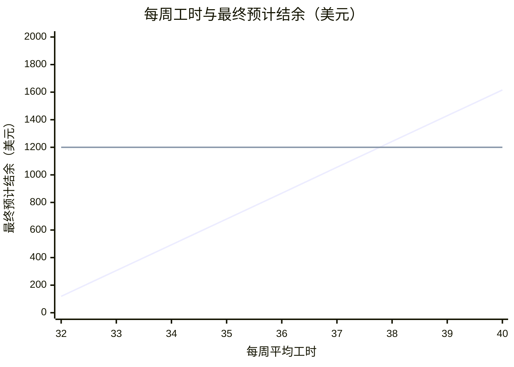

# 岗位分析标准示例

虚构数据与示例汇率，非真实 Offer 或实际汇价。下面是按[Offer 字段提取模板](offer-extraction.md)填写的输入与 `budget.py` 的输出，实际回答原样使用脚本输出。

---

**示例一：单 Offer**

```json
{"mode":"position_overview","fx_cny_per_usd":7.1,"fx_source":"示例参考报价","fx_quote_date":"2026-10-30","project_cost_cny":20000,"offers":[{"id":"example","label":"示例岗位","state":"TX","wage_usd_per_hour":16,"hours_per_week":32,"work_weeks":13,"rent_usd_per_week":120,"food_usd_per_week":80,"transport_usd_per_week":20,"other_weekly_usd":15,"tax":{"federal_income_tax_percent":10,"state_income_tax_percent":0,"fica_percent":0},"details":{"tips":true,"meals":"discount","meal_discount_percent":30,"housing_utilities_included":true,"housing_deposit_usd":300,"housing_deposit_refundable":true,"commute_bike_minutes":10,"second_job_allowed":true,"sponsor":"示例 Sponsor","ssn_required_before_work":false,"open_availability":true,"dress_code":"自备黑色防滑鞋。"},"cautions":{"制服":"制服费用待确认。"}}]}
```

**项目费 ¥20,000，按 $16/h、平均每周 32 小时计算，在美净剩约 $2,935，最终预计结余约 $119（约 ¥841），预计可以回本。**

## 1. 六维分析

| 要素 | Offer 数据 | 分析 |
|---|---|---|
| 收入 | $16/h；平均 32h/周；约 13 周 | 无州所得税，约 10% 的联邦税费 |
| 住宿 | $120/周 | 水电网全包 |
| 生活成本 | 餐饮 $80/周；其他 $15/周 | 员工餐 7 折；州销售税 6.25% |
| 交通 | $20/周 | 住处到岗骑车约 10 分钟；公共交通较弱 |
| 二工 | 可以（需 示例 Sponsor 批准） | 二工收入不计入回本 |
| 落地便利 | 可先开工，再办 SSN |  |

## 2. 回本测算

| 项目 | 每周 | 13 周合计 |
|---|---|---|
| 税前工资 | $512 | $6,656 |
| 预计税费 | −$51 | −$666 |
| 住宿 | −$120 | −$1,560 |
| 餐饮、交通及其他 | −$115 | −$1,495 |
| **在美净剩** | **$226** | **$2,935** |
| 项目费（¥20,000） |  | −$2,817 |
| **最终预计结余** |  | **$119** |

回本进度：▓▓▓▓▓▓▓▓▓▓ 100%
每周净剩 $226，约 12.5 周回本，工期结束时另剩 $119。

汇率 7.1：10 月 30 日示例参考报价，向上取一位小数。

## 3. 特殊注意事项

- **小费**：岗位有小费，金额不固定，未计入回本。
- **排班**：须接受夜班、周末和节假日排班。
- **二工审批**：须先取得 示例 Sponsor 书面批准才能开始，且不得影响一工工时。
- **住房**：押金 $300，首薪前需备现金，离开时可退。
- **着装自备**：自备黑色防滑鞋。
- **SWT 地点背景**：BridgeUSA SWT 地图上，TX 共 1,653（全国第 21 位）。计数不等同于年度去重人数。
- **制服**：制服费用待确认。

## 4. 后续选项

A. 填入实际项目费或小费，重新测算
B. 与其他岗位对比
C. 查看住宿、工作内容与当地生活
D. 判断是否值得选择

回复字母或直接提问。

---

**示例二：两份 Offer**

```json
{"mode":"position_overview","fx_cny_per_usd":7.1,"fx_source":"示例参考报价","fx_quote_date":"2026-10-30","project_cost_cny":20000,"offers":[{"id":"a","label":"示例 A","state":"TX","wage_usd_per_hour":16,"hours_per_week":36,"min_hours":32,"max_hours":40,"work_weeks":13,"rent_usd_per_week":120,"food_usd_per_week":80,"transport_usd_per_week":20,"other_weekly_usd":15,"tax":{"federal_income_tax_percent":10,"state_income_tax_percent":0,"fica_percent":0}},{"id":"b","label":"示例 B","state":"TX","wage_usd_per_hour":14,"hours_per_week":40,"hours_guaranteed":true,"work_weeks":13,"rent_usd_per_week":100,"food_usd_per_week":80,"transport_usd_per_week":0,"other_weekly_usd":15,"tax":{"federal_income_tax_percent":10,"state_income_tax_percent":0,"fica_percent":0},"cautions":{"岗位条款":"制服费用待确认"}}]}
```

**仅从收益看，示例 B 更高，每周多剩约 $26：最终预计结余约 $1,200，示例 A 约 $867；示例 A 每周平均工时达到 37.8 小时以上，才会超过 示例 B。**

## 1. 六维分析

| 要素 | 示例 A | 示例 B | 分析 |
|---|---|---|---|
| 收入 | $16/h；32–40h/周；约 13 周；无州所得税，约 10% 的联邦税费 | $14/h；保证 40h/周；约 13 周；无州所得税，约 10% 的联邦税费 | 示例 A 时薪高 $2；示例 B 平均工时多 4 小时 |
| 住宿 | $120/周 | $100/周 | 示例 B 每周便宜 $20 |
| 生活成本 | 餐饮 $80/周；其他 $15/周；州销售税 6.25% | 餐饮 $80/周；其他 $15/周；州销售税 6.25% |  |
| 交通 | $20/周；公共交通较弱 | $0/周；公共交通较弱 | 示例 B 每周少花 $20 |
| 二工 | 不计入收益（估） | 不计入收益（估） | 二工收入不计入回本 |
| 落地便利 | 办理时间待核验（估） | 办理时间待核验（估） |  |

## 2. 回本测算

| 项目 | 示例 A | 示例 B |
|---|---|---|
| 每周净剩 | $283 | $309 |
| 工期 | 约 13 周 | 约 13 周 |
| 在美净剩 | $3,684 | $4,017 |
| 项目费 | −$2,817 | −$2,817 |
| **最终预计结余** | **$867** | **$1,200** |
| 回本进度 | ▓▓▓▓▓▓▓▓▓▓ 100% | ▓▓▓▓▓▓▓▓▓▓ 100% |

汇率 7.1：10 月 30 日示例参考报价，向上取一位小数。

**岗位收益对比**



- 第 1 条线：示例 A，32–40 小时
- 第 2 条线：示例 B，保证 40 小时

- 每周平均工时约 37.8 小时时，示例 A 和 示例 B 结余持平。
- 32–37.8 小时/周：示例 B 更划算。
- 37.8–40 小时/周：示例 A 更划算。

## 3. 特殊注意事项

**两份岗位共同**

- **SWT 地点背景**：BridgeUSA SWT 地图上，TX 共 1,653（全国第 21 位）。计数不等同于年度去重人数。

**示例 B**

- **岗位条款**：制服费用待确认

## 4. 后续选项

A. 修改工时、餐费或项目费，重新测算
B. 加入二工，测算回本所需工时
C. 查看各地住宿、工作内容与当地生活
D. 判断选择哪个岗位

回复字母或直接提问。
