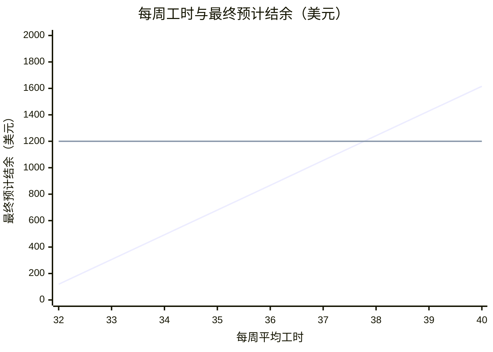

# 岗位分析标准示例

虚构数据与示例汇率，非真实 Offer 或实际汇价。下面是输入与 `budget.py` 的输出；实际分析应以材料来源和用户事实为准。

## 单 Offer

```json
{"mode":"position_overview","fx_cny_per_usd":7.1,"fx_source":"示例参考报价","fx_quote_date":"2026-10-30","project_cost_cny":20000,"offers":[{"id":"example","label":"示例岗位","state":"TX","wage_usd_per_hour":16,"hours_per_week":32,"work_weeks":13,"rent_usd_per_week":120,"food_usd_per_week":80,"transport_usd_per_week":20,"other_weekly_usd":15,"tax":{"federal_income_tax_percent":10,"state_income_tax_percent":0,"fica_percent":0},"cautions":{"岗位条款":"制服费用待确认"}}]}
```

**本岗位预计可以回本：按 $16/h、平均每周 32 小时计算，在美预计结余约 $2,935，扣除项目费 ¥20,000 后，最终预计结余约 $119（约 ¥841）。**

影响回本的关键因素：
1. **二工**：需经 Sponsor 批准；一工排班优先，不计入上述结余。

**岗位概况**

| 要素 | 内容 | 注意事项 |
|---|---|---|
| 工资 | $16/h，平均 32h/周，约 13 周 | 工时不保证 |
| 住宿 | $120/周 |  |
| 餐饮 | $80/周 |  |
| 通勤 | $20/周 |  |
| 落地 | 办理时间待核验（估） |  |

**回本测算**

| 项目 | 金额 |
|---|---|
| 税前工资（$16 × 32h × 13 周） | $6,656 |
| 预计税费 | −$666 |
| 住宿、餐饮、交通及其他 | −$3,055 |
| **在美预计结余** | **$2,935** |
| 项目费（¥20,000 ÷ 7.1） | −$2,817 |
| **最终预计结余** | **$119** |

汇率 7.1：10 月 30 日示例参考报价，向上取一位小数。

**注意事项**

- 岗位条款：制服费用待确认

**后续选项**
A. 填入实际项目费或小费，重新测算
B. 与其他岗位对比
C. 查看住宿、工作内容与当地生活
D. 判断是否值得选择

回复字母或直接提问。

## 两份 Offer

```json
{"mode":"position_overview","fx_cny_per_usd":7.1,"fx_source":"示例参考报价","fx_quote_date":"2026-10-30","project_cost_cny":20000,"offers":[{"id":"a","label":"示例 A","state":"TX","wage_usd_per_hour":16,"hours_per_week":36,"min_hours":32,"max_hours":40,"work_weeks":13,"rent_usd_per_week":120,"food_usd_per_week":80,"transport_usd_per_week":20,"other_weekly_usd":15,"tax":{"federal_income_tax_percent":10,"state_income_tax_percent":0,"fica_percent":0}},{"id":"b","label":"示例 B","state":"TX","wage_usd_per_hour":14,"hours_per_week":40,"hours_guaranteed":true,"work_weeks":13,"rent_usd_per_week":100,"food_usd_per_week":80,"transport_usd_per_week":0,"other_weekly_usd":15,"tax":{"federal_income_tax_percent":10,"state_income_tax_percent":0,"fica_percent":0},"cautions":{"岗位条款":"制服费用待确认"}}]}
```

**仅从收益看，示例 B 更高：示例 B 最终预计结余约 $1,200，示例 A 约 $867；示例 A 每周平均工时达到 37.8 小时以上，才会超过 示例 B。**

影响选择的关键因素：
1. **示例 A 工时不保证**：32 小时约 $119，40 小时约 $1,616。
2. **二工**：均需经 Sponsor 批准，不计入上述结余。

**岗位对比**

| 要素 | 示例 A | 示例 B |
|---|---|---|
| 时薪 | $16 | $14 |
| 工时 | 32–40h/周，不保证 | 40h/周，保证 |
| 工期 | 约 13 周 | 约 13 周 |
| 住宿 | $120/周 | $100/周 |
| 餐饮 | $80/周 | $80/周 |
| 通勤 | $20/周 | $0/周 |
| 在美预计结余 | $3,684 | $4,017 |
| **最终预计结余** | **$867** | **$1,200** |

汇率 7.1：10 月 30 日示例参考报价，向上取一位小数。

**岗位收益对比**



- 第 1 条线：示例 A，32–40 小时
- 第 2 条线：示例 B，保证 40 小时

- 每周平均工时约 37.8 小时时，示例 A 和 示例 B 结余持平。
- 32–37.8 小时/周：示例 B 更划算。
- 37.8–40 小时/周：示例 A 更划算。

**注意事项**

- 示例 B：岗位条款：制服费用待确认

**后续选项**
A. 修改工时、餐费或项目费，重新测算
B. 加入二工，测算回本所需工时
C. 查看各地住宿、工作内容与当地生活
D. 判断选择哪个岗位

回复字母或直接提问。
