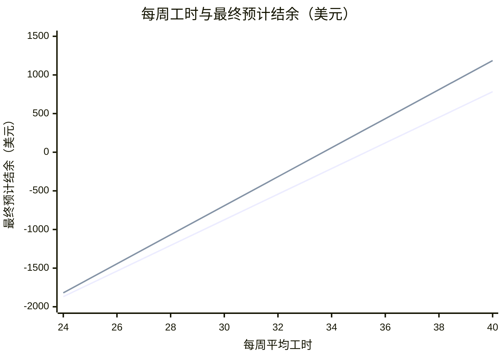

**仅从收益看，Hotel B（City B） 更高：Hotel B（City B） 最终预计结余约 −$317，Restaurant A（City A） 约 −$543。**

## 1. 六维分析

| 要素 | Restaurant A（City A） | Hotel B（City B） | 分析 |
|---|---|---|---|
| 收入 | $15/h；平均 32h/周；约 13 周 | $17/h；平均 32h/周；约 13 周 | 约 15% 的联邦和州税费 |
| 住宿 | $115/周 | $132/周 |  |
| 生活成本 | 餐饮 $80/周；其他 $15/周（估） | 餐饮 $100/周；其他 $15/周（估） |  |
| 交通 | $20/周（估） | $20/周（估） |  |
| 二工 | 不计入预计收入 | 不计入预计收入 | 二工收入不计入回本 |
| 落地便利 | 可以先开工；SSN 到手前可能延迟发薪 | 资料称取得 SSN 后才能开工 |  |

## 2. 回本测算

| 项目 | Restaurant A（City A） | Hotel B（City B） |
|---|---|---|
| 每周净剩 | $178 | $195 |
| 工期 | 约 13 周 | 约 13 周 |
| 在美净剩 | $2,314 | $2,540 |
| 项目费 | −$2,857 | −$2,857 |
| **最终预计结余** | **−$543** | **−$317** |
| 回本进度 | ▓▓▓▓▓▓▓▓░░ 80% | ▓▓▓▓▓▓▓▓▓░ 88% |

汇率 7.0：用户提供。

**岗位收益对比**

- 第 1 条线：Restaurant A（City A），平均 32 小时
- 第 2 条线：Hotel B（City B），平均 32 小时

每周 24–40 小时之间，Hotel B（City B） 都更划算。

## 3. 特殊注意事项

- **SSN 与首薪**：Restaurant A（City A），资料称可先工作，但 SSN 到手前不发工资；延迟到账不等于工资损失
- **时薪**：Restaurant A（City A），$15–17 区间；测算取 $15
- **岗位地点**：Restaurant A（City A），City A 或 City B，无法预选
- **Offer 确认**：Restaurant A（City A），当前为示例招聘资料，需核对正式 Offer
- **SSN 与首薪**：Hotel B（City B），资料称需先取得 SSN 才能开工；等待期间可能减少有薪周数
- **工时**：Hotel B（City B），通常 32h/周；40h 取决于表现，不保证
- **岗位分配**：Hotel B（City B），前台或客房，到岗后分配
- **Offer 确认**：Hotel B（City B），当前为示例招聘资料，需核对正式 Offer

## 4. 后续选项

A. 修改工时、餐费或项目费，重新测算
B. 加入二工，测算回本所需工时
C. 查看各地住宿、工作内容与当地生活
D. 判断选择哪个岗位

回复字母或直接提问。
