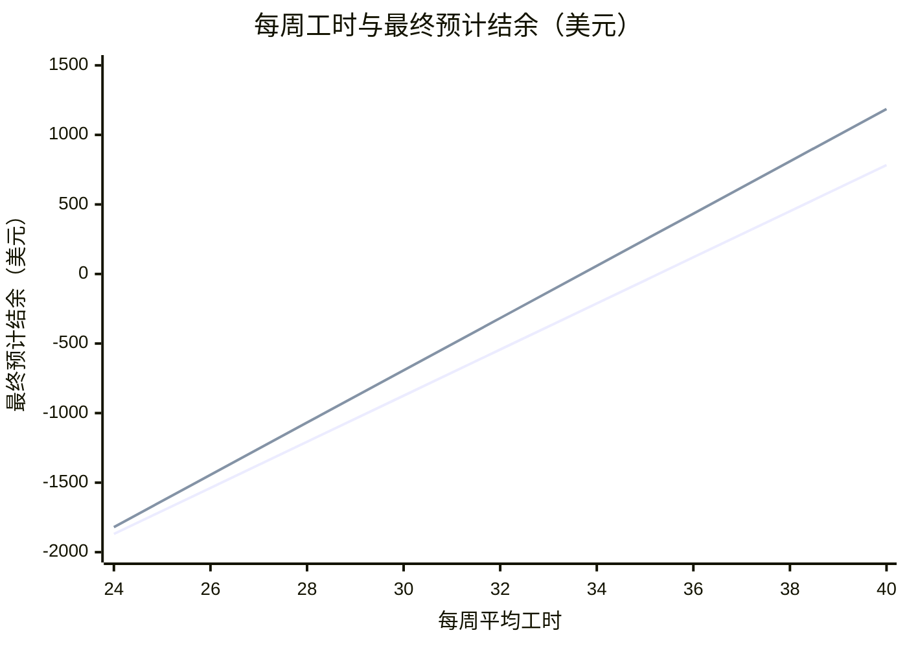

**仅从收益看，Hotel B（City B） 更高，每周多剩约 $17：最终预计结余约 −$317，Restaurant A（City A） 约 −$543；两份岗位按当前工时都无法回本。**

## 1. 六维分析

| 要素 | 项目 | Restaurant A（City A） | Hotel B（City B） | 分析 |
|---|---|---|---|---|
| 收入 | 时薪 | $15/h | $17/h | Hotel B（City B） 高 $2 |
|  | 工时 | 平均 32h/周 | 平均 32h/周 |  |
|  | 工期 | 约 13 周 | 约 13 周 |  |
|  | 税费 | 约 15%（联邦和州） | 约 15%（联邦和州） |  |
| 住宿 | 周租 | $115/周 | $132/周 | Restaurant A（City A） 每周少 $17 |
| 生活成本 | 餐饮 | $80/周 | $100/周 | Restaurant A（City A） 每周少 $20 |
|  | 其他开销 | $15/周（估） | $15/周（估） |  |
| 交通 | 交通费 | $20/周（估） | $20/周（估） |  |
| 二工 |  | 不计入预计收入 | 不计入预计收入 | 二工收入不计入回本 |
| 落地便利 | SSN | 可以先开工；SSN 到手前可能延迟发薪 | 资料称取得 SSN 后才能开工 |  |

## 2. 回本测算

| 项目 | Restaurant A（City A） | Hotel B（City B） |
|---|---|---|
| 每周净剩 | $178 | $195 |
| 工期 | 约 13 周 | 约 13 周 |
| 在美净剩 | $2,314 | $2,540 |
| 项目费 | −$2,857 | −$2,857 |
| **最终预计结余** | **−$543** | **−$317** |
| 回本进度 | ▓▓▓▓▓▓▓▓░░ 80% | ▓▓▓▓▓▓▓▓▓░ 88% |

汇率 7.0：用户提供。

**岗位收益对比**

- 第 1 条线：Restaurant A（City A），平均 32 小时
- 第 2 条线：Hotel B（City B），平均 32 小时

每周 24–40 小时之间，Hotel B（City B） 都更划算。

## 3. 特殊注意事项

**两份岗位共同**

- **Offer 确认**：当前为示例招聘资料，需核对正式 Offer

**Restaurant A（City A）**

- **SSN 与首薪**：资料称可先工作，但 SSN 到手前不发工资；延迟到账不等于工资损失
- **时薪**：$15–17 区间；测算取 $15
- **岗位地点**：City A 或 City B，无法预选

**Hotel B（City B）**

- **SSN 与首薪**：资料称需先取得 SSN 才能开工；等待期间可能减少有薪周数
- **工时**：通常 32h/周；40h 取决于表现，不保证
- **岗位分配**：前台或客房，到岗后分配

## 4. 后续选项

A. 修改工时、餐费或项目费，重新测算
B. 加入二工，测算回本所需工时
C. 查看各地住宿、工作内容与当地生活
D. 判断选择哪个岗位

回复字母或直接提问。
